

  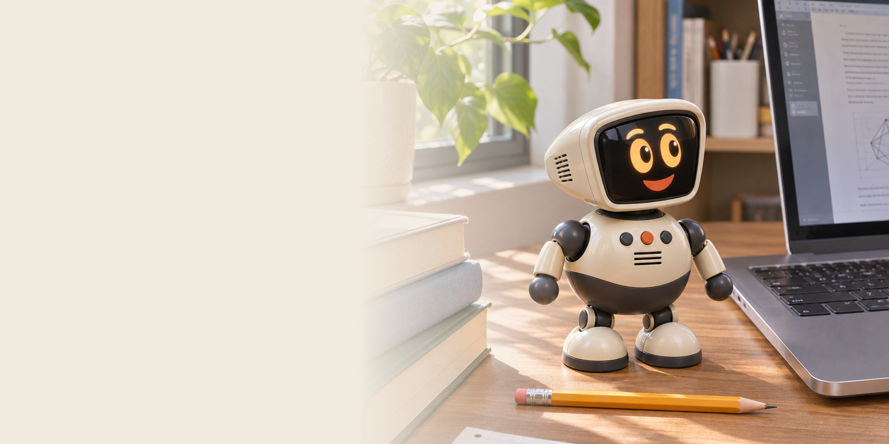

<h1 align="center">Odi · AI Desk Companion Robot</h1>

  <b>A 15 cm robot that helps students and remote workers focus, take breaks and work healthier.</b> 
  Embedded firmware · custom PCBs · 3D-printed mechanics · native iOS &amp; Android apps · cloud backend · voice AI

  <a href="README.tr.md">Türkçe</a> ·
  <a href="#demo">Demo</a> ·
  <a href="#what-i-built">What I built</a> ·
  <a href="#validation">Validation</a> ·
  <a href="#architecture">Architecture</a> ·
  <a href="#tech-stack">Tech stack</a>

> **Showcase repository.** This repo presents the project; the source code, schematics, CAD files and cloud configuration live in a private repository. Everything here is media and documentation only.

---

## Demo

   
  <a href="assets/video/odi-promo-v2.mp4">Full promo video (MP4, 1080p)</a>

## The idea

Odi sits on your desk with a digital face on a small retro-TV head. You say **"Hey Odi"**, start a Pomodoro, and Odi keeps the rhythm: focus time, breaks, water and posture reminders. Put your phone on its dock and Odi switches to **Deep Focus**. A companion app on iPhone and Android shows sessions, history and settings; a web panel handles setup and privacy.

Odi is a wellbeing and productivity assistant, **not a medical device**: it never diagnoses or gives treatment advice.

| Focus | Voice | Apps | Hardware |
|---|---|---|---|
|  | 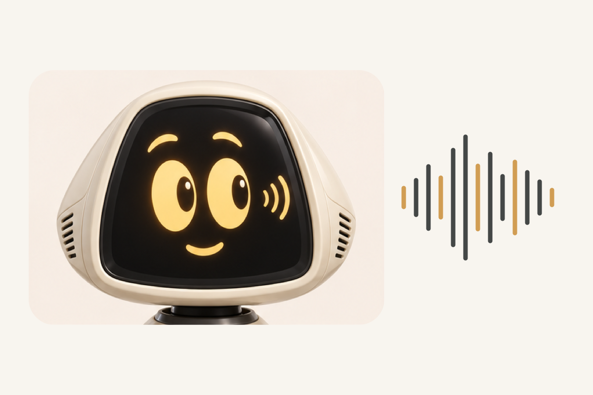 |  | 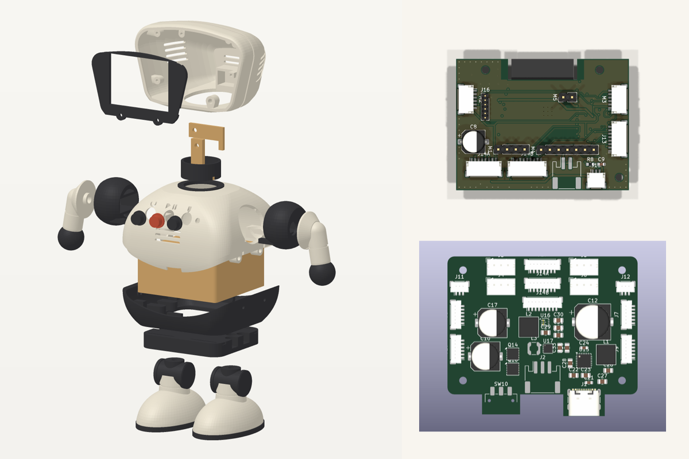 |
| Five focus techniques (Pomodoro, 52/17, Flowtime, Ultradian 90, Deep Work), alarms and countdowns | On-device "Hey Odi" wake-word model (62 KB int8), Turkish speech pipeline (STT → LLM tools → TTS), push-to-talk | Native SwiftUI and Jetpack Compose apps with live sync and offline queue | ESP32-S3, 2.0" IPS face, I2S audio, 7 servos, 1S2P Li-Po, BLE + Wi-Fi |

## What I built

### Embedded firmware
- **ESP-IDF 5.5** firmware for the ESP32-S3 (C++), with a hardware-independent core library shared by the firmware, a **Wokwi** simulator build and native unit tests.
- 30 fps animated face on a 320 × 240 ST7789 display; expressions designed frame by frame.
- Session engine with five focus techniques, alarms, countdowns that survive reboots, reminder scheduler and power modes (Focus / Eco / Sleep).
- **BLE setup service** (NimBLE GATT, LE Secure Connections with numeric comparison, bonded reconnection) and an MQTT device protocol with versioned JSON messages and golden test fixtures.
- **On-device wake word:** a custom "Hey Odi" streaming model (microWakeWord, TensorFlow → int8 TFLite Micro, 62 KB, ~25k MACs per 30 ms inference) trained on a synthetic Turkish data pipeline with hard negatives ("Hey Kodi", "Hey Odin", …); threshold chosen from my own false-accept / false-reject evaluation. Streaming voice over WSS with Opus audio.
- Safety by design: servo power is cut by a hardware heartbeat latch (< 100 ms), independent of Wi-Fi, apps and AI; servo start-up is sequenced and the current budget follows battery voltage; the microphone has a hardware kill switch.
- Bring-up console (esp_console) with drivers for the charger, fuel gauge, IMU, servo driver and distance sensors, ready for first hardware tests.
- **Over-the-air updates:** dual-slot OTA with SHA-256 and version checks, battery and session guards, self-test on first boot and automatic rollback; progress and failure reasons are reported to the apps.
- **Per-device X.509 identity:** the key pair is generated on the robot and never leaves it; certificates are signed by an environment-specific intermediate CA (offline root), the broker accepts only mutual-TLS clients, and certificates renew themselves before expiry.

  
  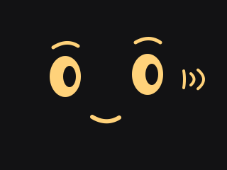
  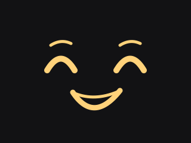
  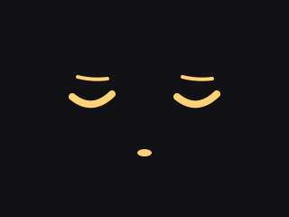

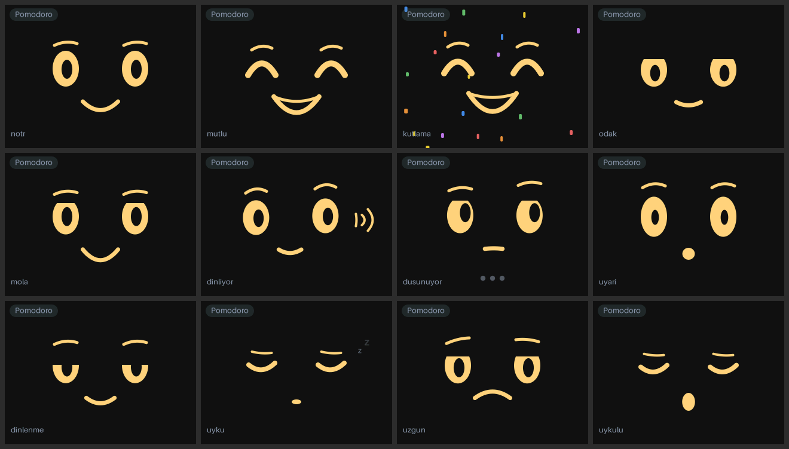

### Electronics and PCB design
- Two custom **4-layer PCBs** designed in **KiCad**: a 50 × 38 mm head board (ESP32-S3 module, display, I2S microphones and amplifier) and a 55 × 40 mm body power board.
- Chip-down power design: Li-ion charger with power path, 5 V / 3 A boost for the servos, 3.3 V buck-boost, fuel gauge, IMU, 16-channel PWM servo driver, reverse-polarity protected load switch.
- Head board fully routed on 4 layers (signal / solid ground / power / signal) with zero ERC and DRC errors; continuous ground plane under the radio, antenna keep-out per the module vendor's layout guide, keyed board-to-board harness.

| Head board, routed (front) | Head board, routed (back) | Body board (placement) |
|---|---|---|
| 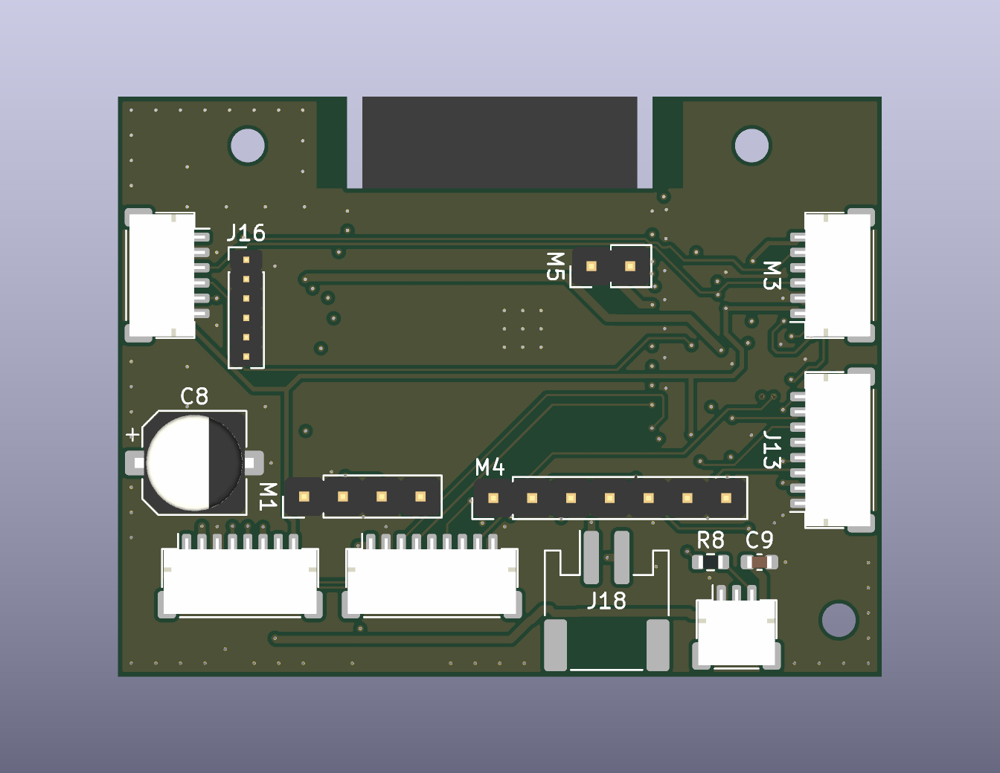 | 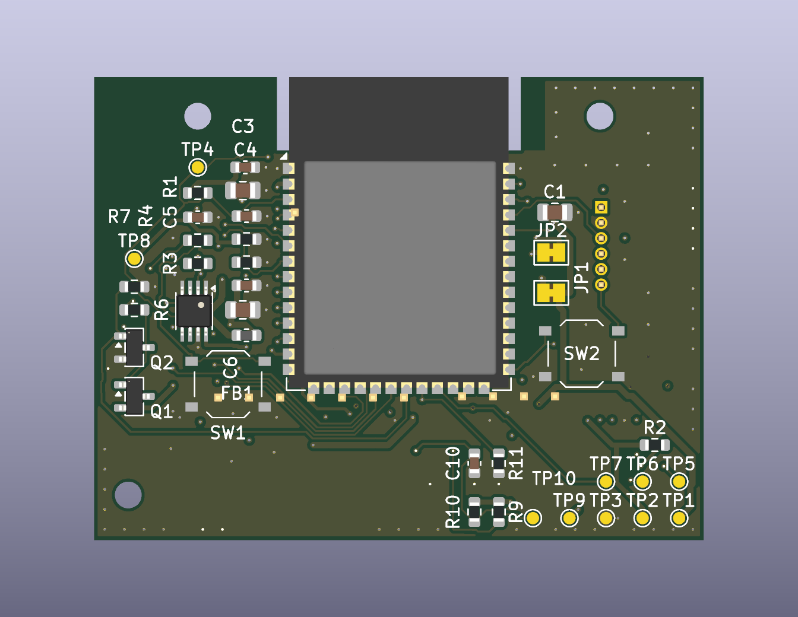 | 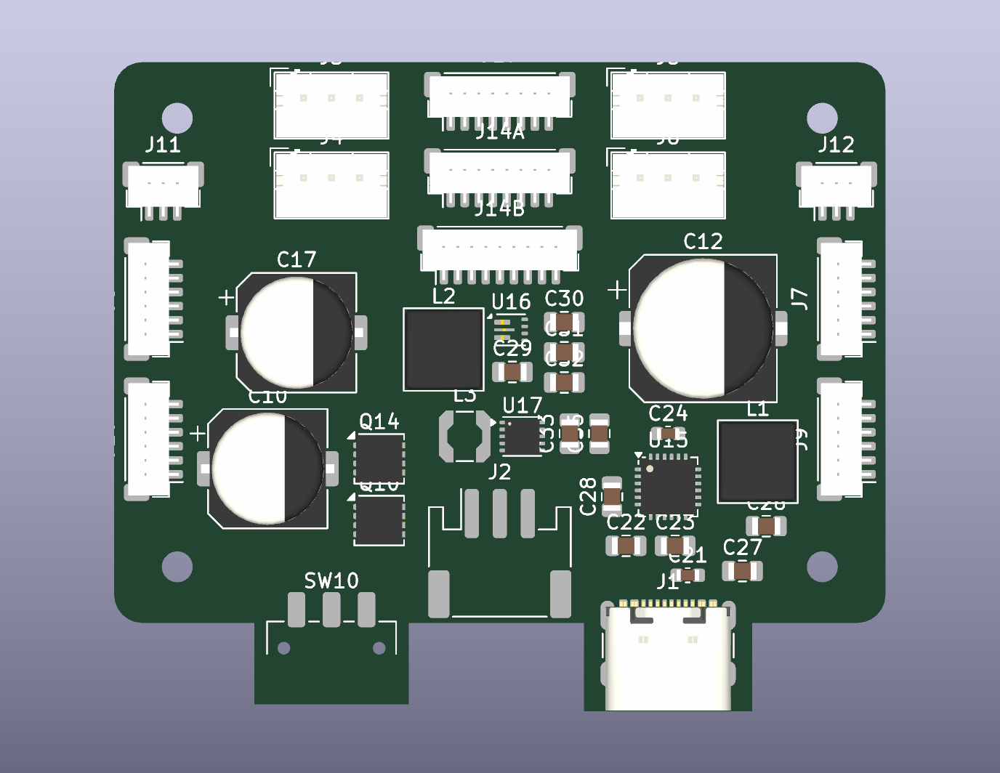 |

### Phone base station
- A separate dock (ESP32-C3, load cell + HX711, NFC tag) detects when the phone is put down and switches Odi into **Deep Focus**.
- Own 2-layer PCB (ERC/DRC clean) and a support-free printable enclosure; firmware with a filtered dock-state machine, drift tracking and fault detection, and a bonded BLE GATT service. Odi keeps a power-aware BLE link to it (connected in Focus, periodic reads in Eco).

| Station board | Station enclosure |
|---|---|
| 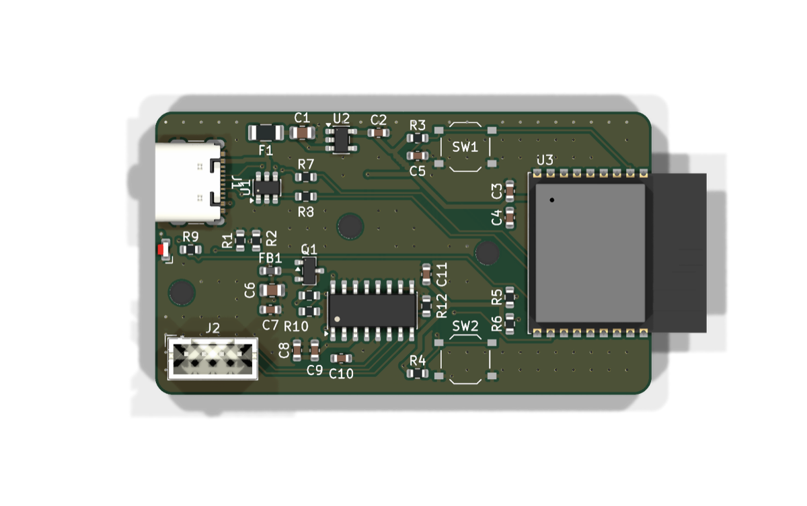 | 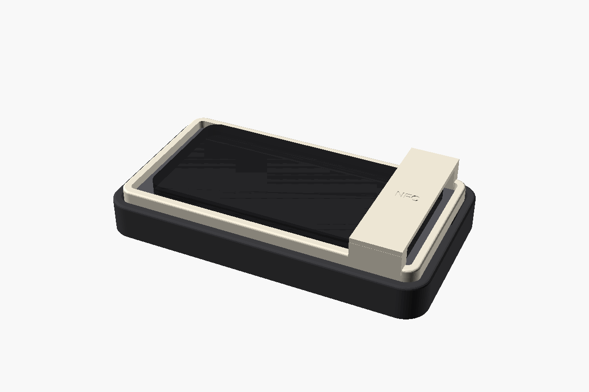 |

### Mechanical design
- Parametric enclosure modeled in **OpenSCAD**: 148 mm tall, 412 g, tip-over angle ≥ 24°; internal layout kept independent from the outer shell so the shell can be redesigned freely.
- Automated checks for part collisions at every joint angle, mass and centre of gravity; print-ready plates for a **Bambu Lab A1**, with heat-set insert bosses and servo mounts.

| Enclosure | Exploded view | Section | Motion |
|---|---|---|---|
| 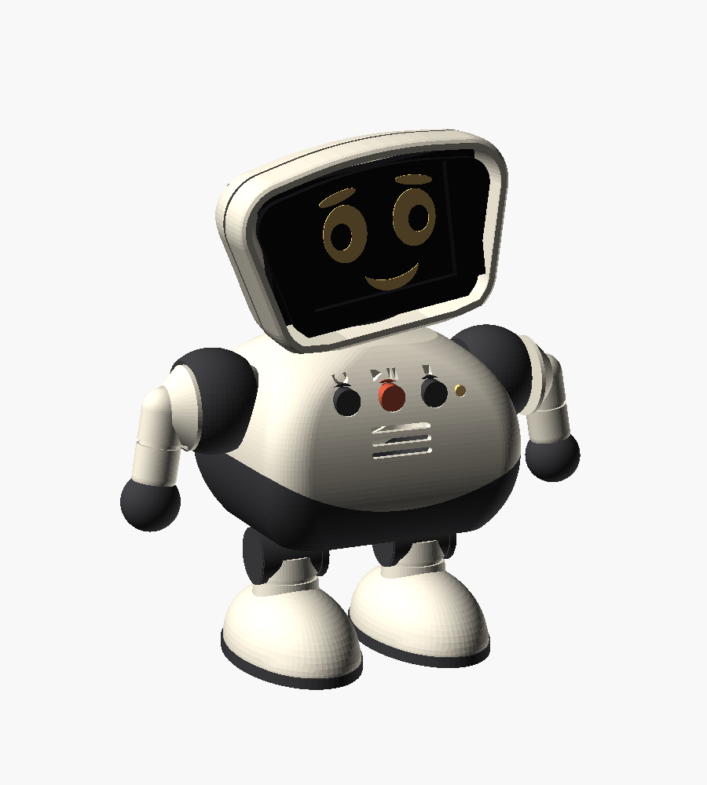 |  | 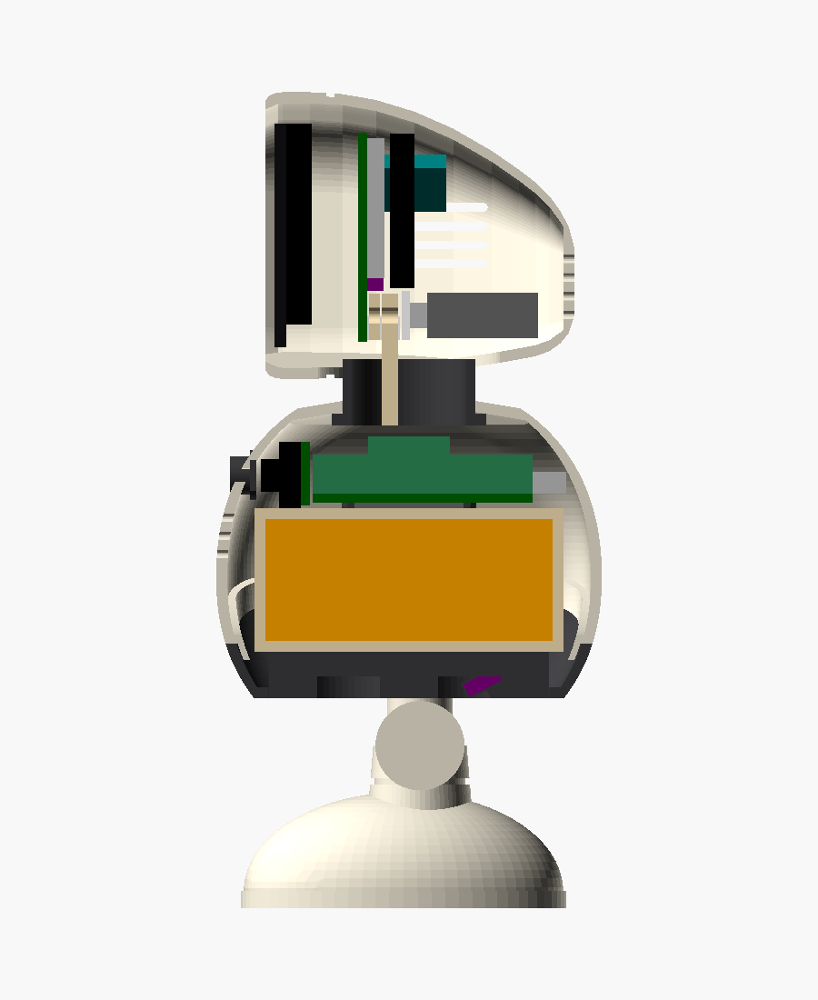 |  |

### Mobile apps
- **iOS** (Swift, SwiftUI, Swift Concurrency) and **Android** (Kotlin, Jetpack Compose, Coroutines/Flow, Room, WorkManager): two native apps with feature parity, no cross-platform framework.
- Live device state over Realtime, optimistic updates with rollback, offline command queue and local cache.
- Device capabilities: BLE onboarding flow, HealthKit / Health Connect daily summaries (raw health data never leaves the phone), Deep Focus with Focus Filters / Do Not Disturb rules, Live Activity and ongoing notifications, background sync.
- Shared design tokens and 600+ localized strings generated for both platforms from one source.

  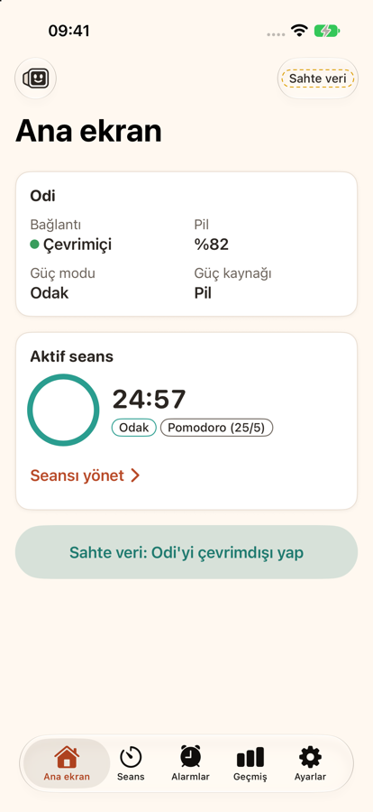
  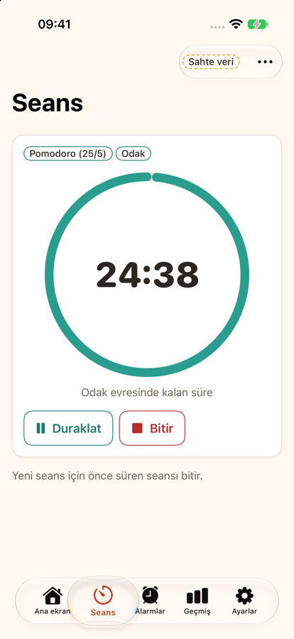
  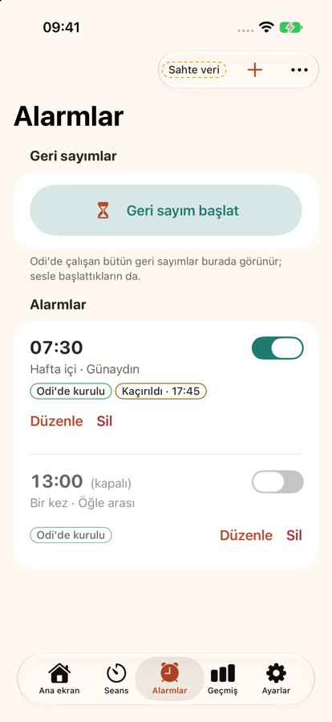
  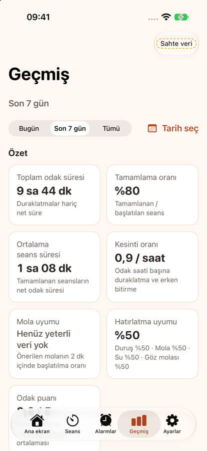
  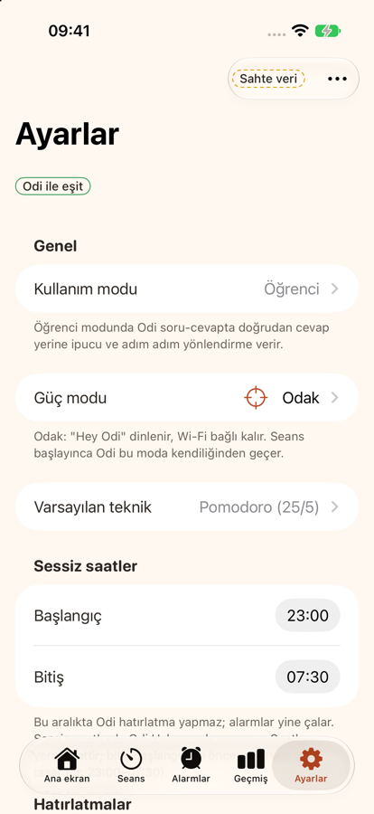

  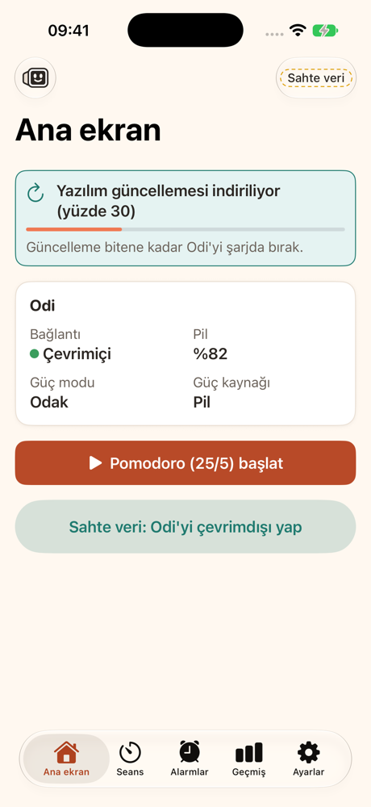
  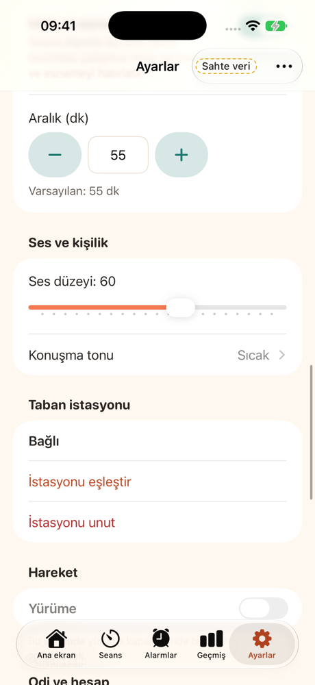

iOS app in demo-data mode (Turkish UI).

### Cloud and web
- **Supabase** (Postgres, Row Level Security, Realtime, pg_cron) with versioned migrations tested against an in-memory Postgres.
- Deployment ready for an EU VPS: Docker Compose stack (Mosquitto with mTLS and per-device ACLs, Caddy with automatic certificates), hardened server setup script, health endpoints, backups.
- **TypeScript** MQTT bridge, a device-certificate provisioning service, a virtual robot for end-to-end tests, and a **voice gateway** (WebSocket audio, streaming STT/TTS, LLM tool calls mapped to device commands, safety layer).
- **Next.js** web panel: dashboard, sessions, alarms, history, setup wizard and a privacy center with data export and scheduled deletion.

## Validation

Before ordering any parts, I checked the critical circuits in **SPICE** (ngspice, scripted from Python) with parameter sweeps over component tolerances and battery voltage: **6 circuits, 24 pass/fail criteria, all passing** with a stated margin. The simulations found four real design problems, which I fixed in the schematic and firmware before layout:

| Finding | Fix |
|---|---|
| Servo start-up inrush of 11 A would brown out the 3.3 V rail | Bulk capacitance, soft start, sequenced servo enable and a battery-voltage current budget in firmware → 5.3 A peak |
| Battery load switch turn-on spike | Gate RC slew control → 4.4 A peak, < 0.5 mJ switching energy |
| I2C rise time too slow across the neck harness | Stronger pull-ups → 254 ns (limit 300 ns) |
| Safety latch could release on a single missed heartbeat | Faster heartbeat and retuned latch timing → 22 ms margin, servo power off in ≤ 88 ms worst case |

| Safety latch: servo power cut after the heartbeat stops | Servo inrush across tolerance corners |
|---|---|
| 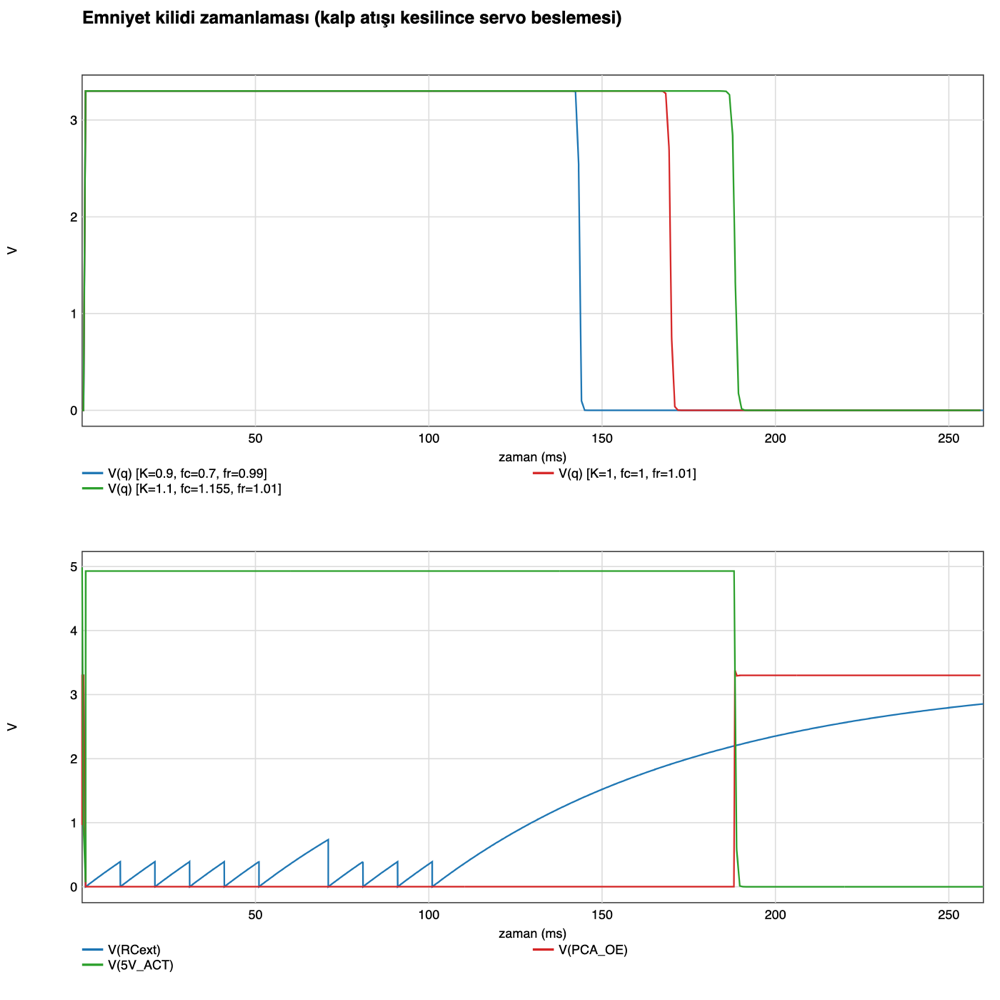 | 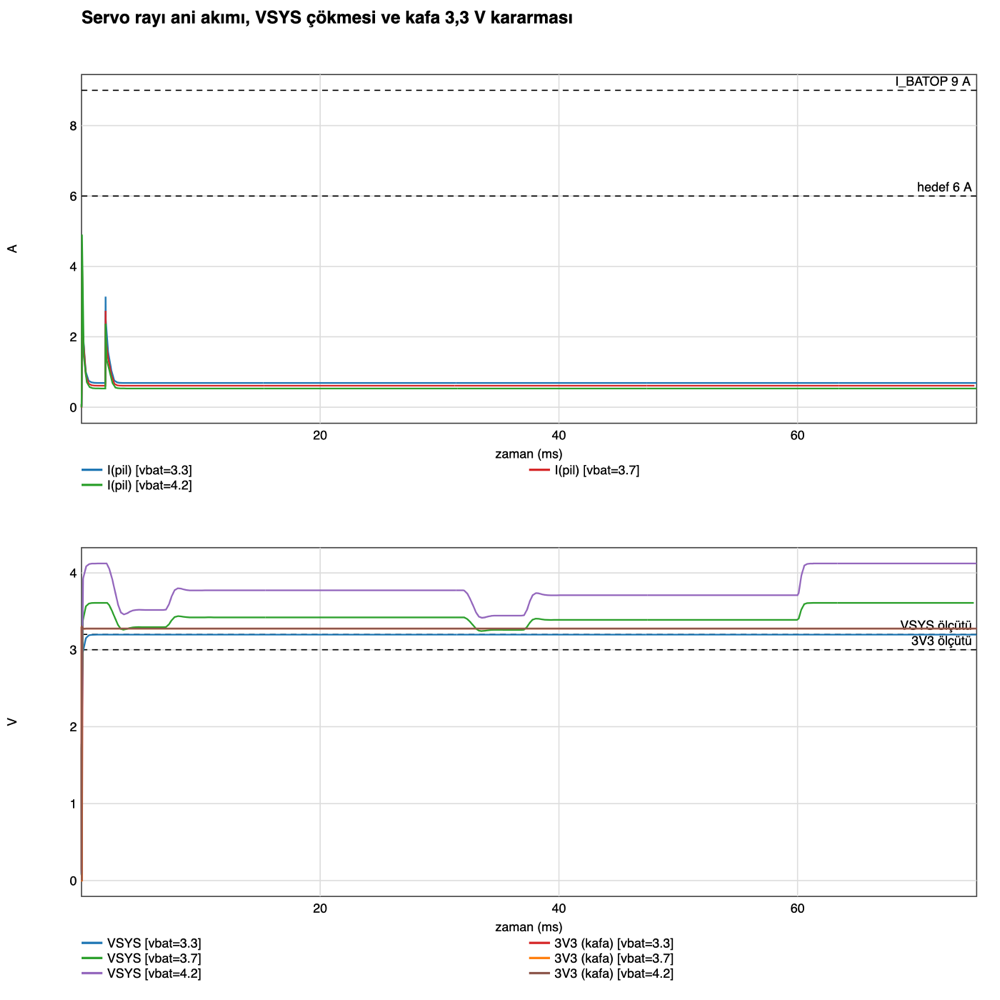 |

Other checks: automated mechanical collision, mass and tip-over checks; KiCad ERC/DRC; a P0 bring-up plan with a test step for every subsystem.

## Architecture

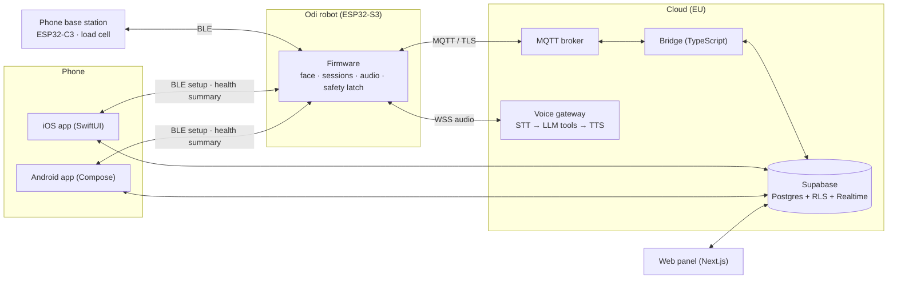

## Tech stack

| Area | Technologies |
|---|---|
| Firmware | C++17, ESP-IDF 5.5, FreeRTOS, NimBLE (peripheral + central), mbedTLS, OTA with rollback, PlatformIO, Wokwi, Unity tests |
| Electronics | KiCad 10, 4-layer PCB, SPICE (ngspice), ESP32-S3, BQ25895, TPS61022, TPS63031, MAX17048, PCA9685, I2S MEMS mics |
| Mechanics | OpenSCAD, Python geometry checks, Bambu Lab A1 (PLA / PETG / TPU) |
| iOS | Swift 6, SwiftUI, Swift Concurrency, CoreBluetooth, HealthKit, ActivityKit, Swift Testing |
| Android | Kotlin 2.4, Jetpack Compose, Coroutines/Flow, Room, DataStore, WorkManager, Health Connect, JUnit |
| Backend | Supabase (Postgres, RLS, Realtime, pg_cron), TypeScript, Node.js, MQTT, Zod, WebSocket, X.509 PKI, Docker Compose, Caddy |
| Web | Next.js 16, React, TypeScript, Vitest |
| AI and voice | TensorFlow, microWakeWord, TFLite Micro (on-device wake word), Opus audio, Whisper / cloud STT, LLM tool calling, Piper / cloud TTS |
| Quality | 1,100+ automated tests across firmware, backend, web and apps; CI with docs and unit checks |

## Engineering principles

- **Safety first:** motion can always be stopped in hardware, regardless of software state.
- **Privacy by design:** raw audio is never stored, raw health data stays on the phone, no AI provider keys on the device, row-level security on every table, user-initiated data export and deletion.
- **Not a medical device:** wording across the robot, apps and web is reviewed to stay non-diagnostic.
- **Test what you ship:** shared wire-protocol fixtures are checked by the firmware, backend and both apps.

## Status

Prototype phase: firmware, apps, backend, PCB designs and circuit simulations are done; the first hardware bring-up (P0) is next, followed by retraining the wake word on real recordings.

## License

© All rights reserved. The images, videos and text in this repository may not be copied, modified or used without written permission. See [LICENSE](LICENSE).
