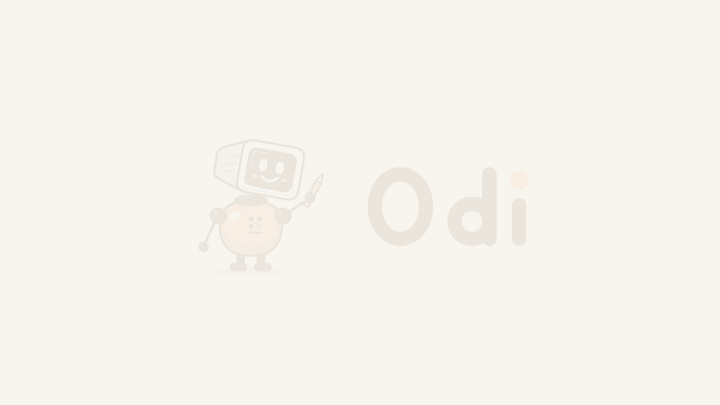
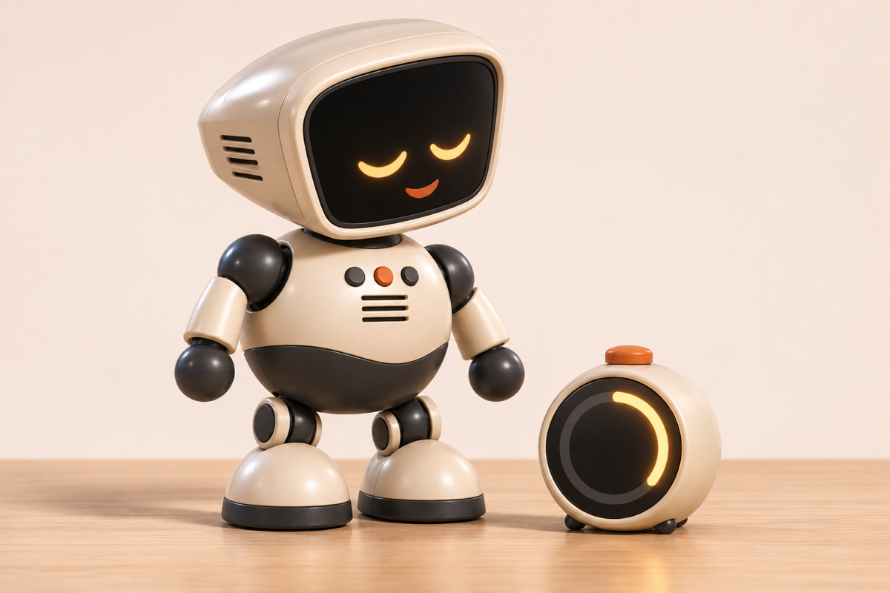
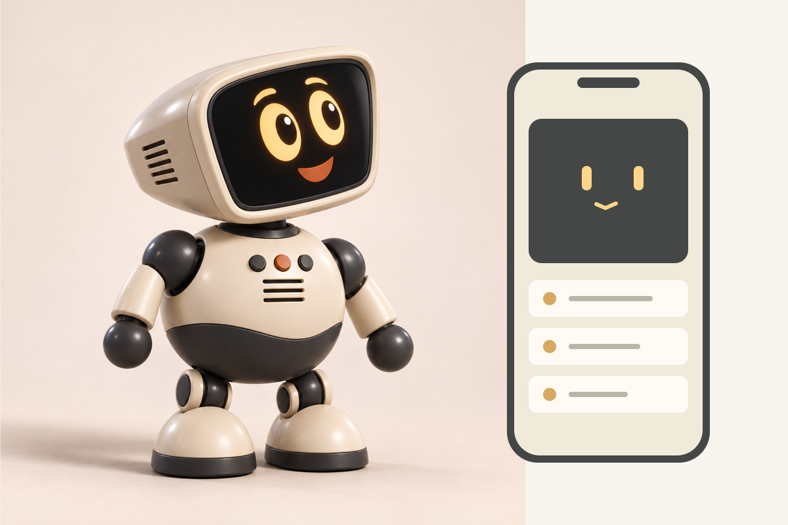
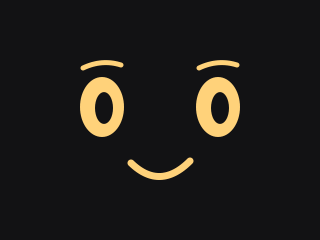
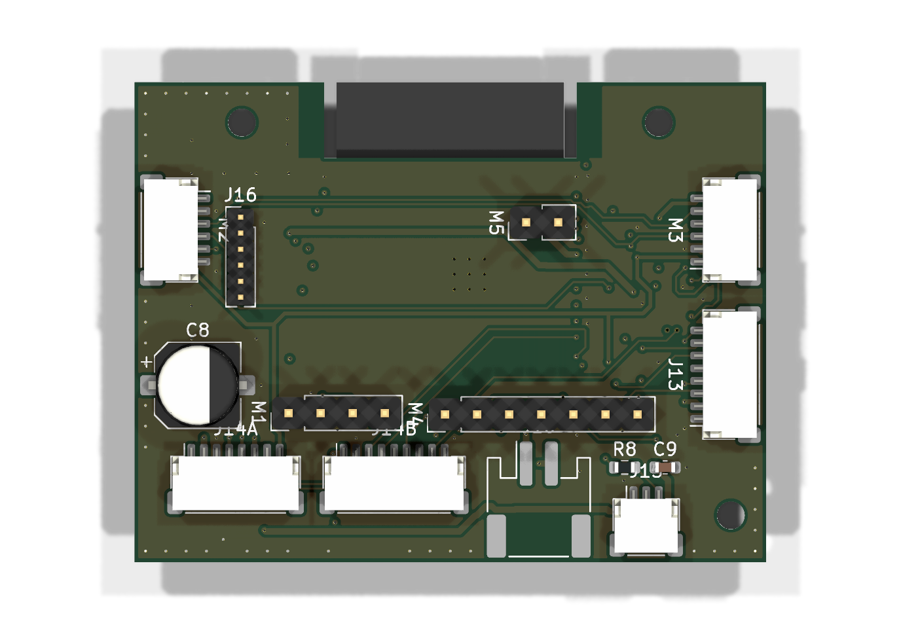
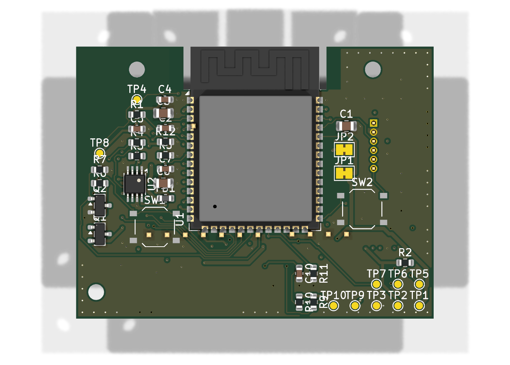
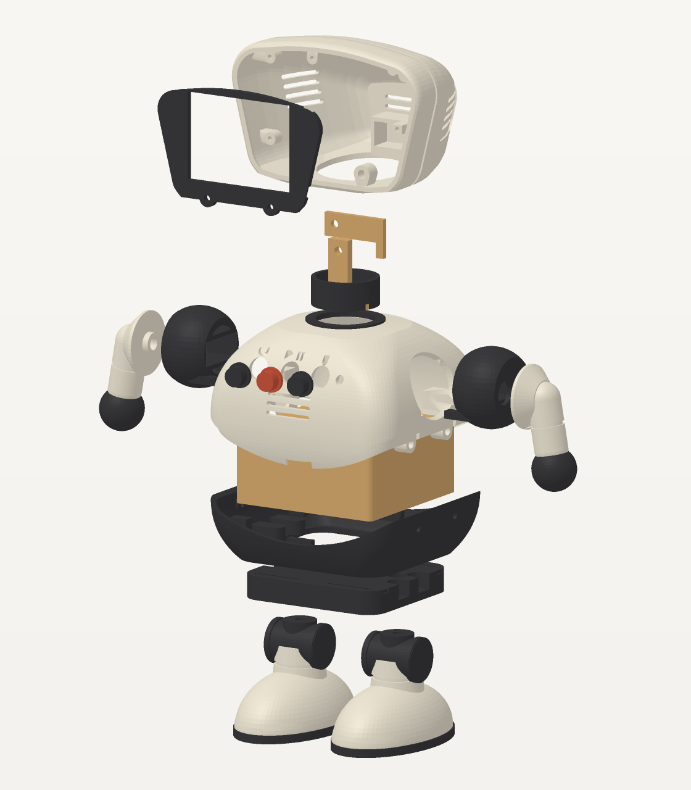
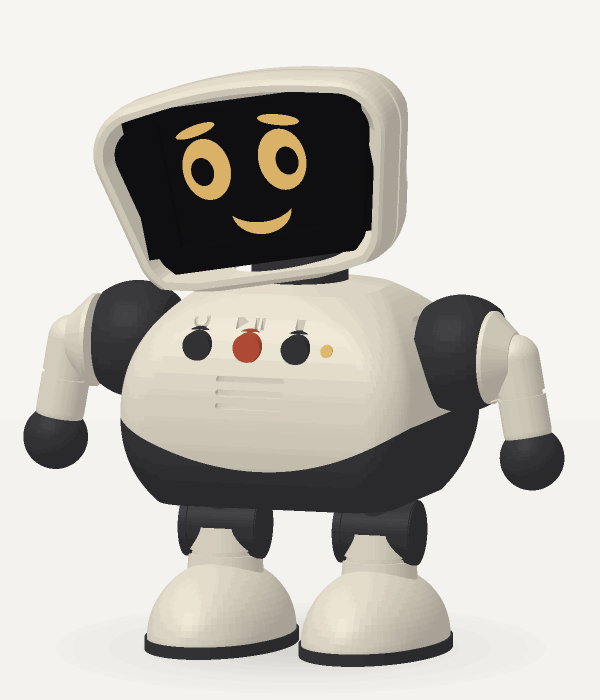
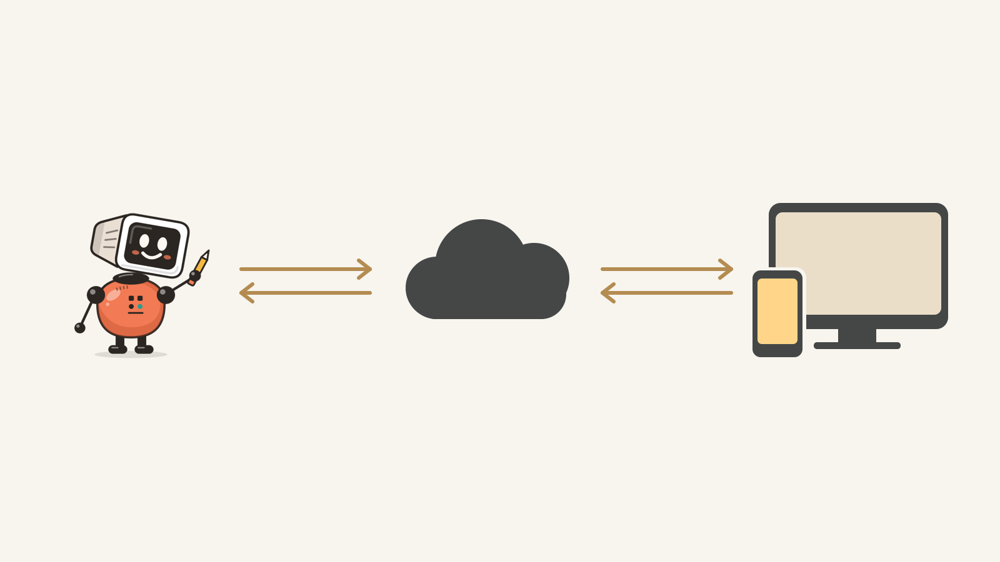
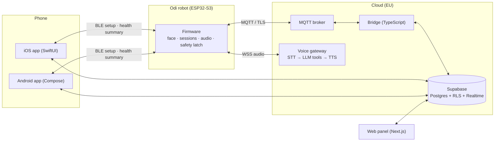

  

<h1 align="center">Odi · AI Desk Companion Robot</h1>

  <b>A 15 cm robot that helps students and remote workers focus, take breaks and work healthier.</b> 
  Embedded firmware · custom PCBs · 3D-printed mechanics · native iOS &amp; Android apps · cloud backend · voice AI

  <a href="README.tr.md">Türkçe</a> ·
  <a href="#demo">Demo</a> ·
  <a href="#what-i-built">What I built</a> ·
  <a href="#architecture">Architecture</a> ·
  <a href="#tech-stack">Tech stack</a>

> **Showcase repository.** This repo presents the project; the source code, schematics, CAD files and cloud configuration live in a private repository. Everything here is media and documentation only.

---

## Demo

   
  <a href="assets/video/odi-promo.mp4">Full promo video (MP4, 1080p)</a>

## The idea

Odi sits on your desk with a digital face on a small retro-TV head. You say **"Hey Odi"**, start a Pomodoro, and Odi keeps the rhythm: focus time, breaks, water and posture reminders. Put your phone on its dock and Odi switches to **Deep Focus**. A companion app on iPhone and Android shows sessions, history and settings; a web panel handles setup and privacy.

Odi is a wellbeing and productivity assistant, **not a medical device**: it never diagnoses or gives treatment advice.

| Focus | Voice | Apps | Hardware |
|---|---|---|---|
|  |  |  |  |
| Five focus techniques (Pomodoro, 52/17, Flowtime, Ultradian 90, Deep Work), alarms and countdowns | "Hey Odi" wake-word data pipeline, Turkish speech pipeline (STT → LLM tools → TTS), push-to-talk | Native SwiftUI and Jetpack Compose apps with live sync and offline queue | ESP32-S3, 2.0" IPS face, I2S audio, 7 servos, 1S2P Li-Po, BLE + Wi-Fi |

## What I built

### Embedded firmware
- **ESP-IDF 5.5** firmware for the ESP32-S3 (C++), with a hardware-independent core library shared by the firmware, a **Wokwi** simulator build and native unit tests.
- 30 fps animated face on a 320 × 240 ST7789 display; expressions designed frame by frame.
- Session engine with five focus techniques, alarms, countdowns that survive reboots, reminder scheduler and power modes (Focus / Eco / Sleep).
- **BLE setup service** (NimBLE GATT, LE Secure Connections with numeric comparison, bonded reconnection) and an MQTT device protocol with versioned JSON messages and golden test fixtures.
- Safety by design: servo power is cut by a hardware heartbeat latch (< 100 ms), independent of Wi-Fi, apps and AI; the microphone has a hardware kill switch.

  
  
  
  

### Electronics and PCB design
- Two custom **4-layer PCBs** designed in **KiCad**: a 50 × 38 mm head board (ESP32-S3 module, display, I2S microphones and amplifier) and a 55 × 40 mm body power board.
- Chip-down power design: Li-ion charger with power path, 5 V / 3 A boost for the servos, 3.3 V buck-boost, fuel gauge, IMU, 16-channel PWM servo driver, reverse-polarity protected load switch.
- Electrical rules check with zero errors, continuous ground plane under the radio, antenna keep-out per the module vendor's layout guide, keyed board-to-board harness.

| Head board (front) | Head board (back) | Body board (placement) |
|---|---|---|
|  |  |  |

### Mechanical design
- Parametric enclosure modeled in **OpenSCAD**: 148 mm tall, 412 g, tip-over angle ≥ 24°; internal layout kept independent from the outer shell so the shell can be redesigned freely.
- Automated checks for part collisions at every joint angle, mass and centre of gravity; print-ready plates for a **Bambu Lab A1**, with heat-set insert bosses and servo mounts.

| Enclosure | Exploded view | Section | Motion |
|---|---|---|---|
|  |  |  |  |

### Mobile apps
- **iOS** (Swift, SwiftUI, Swift Concurrency) and **Android** (Kotlin, Jetpack Compose, Coroutines/Flow, Room, WorkManager): two native apps with feature parity, no cross-platform framework.
- Live device state over Realtime, optimistic updates with rollback, offline command queue and local cache.
- Device capabilities: BLE onboarding flow, HealthKit / Health Connect daily summaries (raw health data never leaves the phone), Deep Focus with Focus Filters / Do Not Disturb rules, Live Activity and ongoing notifications, background sync.
- Shared design tokens and 600+ localized strings generated for both platforms from one source.

  
  
  
  
  

iOS app in demo-data mode (Turkish UI).

### Cloud and web
- **Supabase** (Postgres, Row Level Security, Realtime, pg_cron) with versioned migrations tested against an in-memory Postgres.
- **TypeScript** MQTT bridge, a virtual robot for end-to-end tests, and a **voice gateway** (WebSocket audio, streaming STT/TTS, LLM tool calls mapped to device commands, safety layer).
- **Next.js** web panel: dashboard, sessions, alarms, history, setup wizard and a privacy center with data export and scheduled deletion.

## Architecture

## Tech stack

| Area | Technologies |
|---|---|
| Firmware | C++17, ESP-IDF 5.5, FreeRTOS, NimBLE, PlatformIO, Wokwi, Unity tests |
| Electronics | KiCad 10, 4-layer PCB, ESP32-S3, BQ25895, TPS61022, TPS63031, PCA9685, I2S MEMS mics |
| Mechanics | OpenSCAD, Python geometry checks, Bambu Lab A1 (PLA / PETG / TPU) |
| iOS | Swift 6, SwiftUI, Swift Concurrency, CoreBluetooth, HealthKit, ActivityKit, Swift Testing |
| Android | Kotlin 2.4, Jetpack Compose, Coroutines/Flow, Room, DataStore, WorkManager, Health Connect, JUnit |
| Backend | Supabase (Postgres, RLS, Realtime, pg_cron), TypeScript, Node.js, MQTT, Zod, WebSocket |
| Web | Next.js 16, React, TypeScript, Vitest |
| AI and voice | Wake-word training pipeline (synthetic data), Whisper / cloud STT, LLM tool calling, Piper / cloud TTS |
| Quality | 1,100+ automated tests across firmware, backend, web and apps; CI with docs and unit checks |

## Engineering principles

- **Safety first:** motion can always be stopped in hardware, regardless of software state.
- **Privacy by design:** raw audio is never stored, raw health data stays on the phone, no AI provider keys on the device, row-level security on every table, user-initiated data export and deletion.
- **Not a medical device:** wording across the robot, apps and web is reviewed to stay non-diagnostic.
- **Test what you ship:** shared wire-protocol fixtures are checked by the firmware, backend and both apps.

## Status

Prototype phase: firmware, apps, backend and both PCB designs are implemented and tested in simulation; first hardware bring-up is next.

## License

© All rights reserved. The images, videos and text in this repository may not be copied, modified or used without written permission. See [LICENSE](LICENSE).
