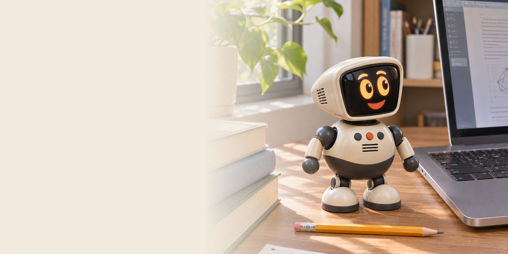

  

<h1 align="center">Odi · Yapay Zekâ Destekli Masa Arkadaşı Robot</h1>

  <b>Öğrencilerin ve evden çalışanların odaklanmasına, mola vermesine ve daha sağlıklı çalışmasına yardım eden 15 cm'lik bir robot.</b> 
  Gömülü yazılım · özel PCB'ler · 3B baskı mekanik · yerel iOS ve Android uygulamaları · bulut altyapısı · sesli yapay zekâ

<a href="README.md">English</a>

> **Tanıtım deposu.** Bu depo projeyi tanıtır; kaynak kod, şemalar, CAD dosyaları ve bulut yapılandırması özel bir depodadır. Burada yalnızca görsel ve doküman vardır.

## Tanıtım

   
  <a href="assets/video/odi-promo-v2.mp4">Tam tanıtım videosu (MP4, 1080p)</a>

## Fikir

Odi masanda durur; küçük retro TV biçimli kafasında dijital bir yüz vardır. **"Hey Odi"** dersin, Pomodoro başlatırsın; Odi ritmi tutar: odak süresi, molalar, su ve duruş hatırlatmaları. Telefonu istasyonuna koyunca Odi **Derin Odak**'a geçer. iPhone ve Android uygulaması seansları, geçmişi ve ayarları gösterir; web paneli kurulumu ve gizliliği yönetir.

Odi bir iyi oluş ve üretkenlik asistanıdır, **tıbbi cihaz değildir**: teşhis koymaz, tedavi önermez.

## Neler yaptım

- **Gömülü yazılım:** ESP32-S3 için ESP-IDF 5.5 (C++) firmware; donanımdan bağımsız çekirdek kütüphane (firmware, Wokwi simülasyonu ve birim testlerinde ortak); 320 × 240 ekranda 30 kare/sn animasyonlu yüz; beş odak tekniği, alarmlar, yeniden başlatmada süren geri sayımlar, güç modları; NimBLE ile BLE kurulum servisi (sayı karşılaştırmalı güvenli eşleştirme); sürümlü MQTT cihaz protokolü; servo beslemesini < 100 ms'de kesen donanımsal emniyet kilidi ve donanımsal mikrofon kapatma anahtarı; cihaz üstünde çalışan özel **"Hey Odi"** uyandırma modeli (TensorFlow → int8 TFLite Micro, 62 KB; sentetik Türkçe veri hattı ve zor olumsuz örneklerle eğitildi); Opus sesle WSS üzerinden akan sesli konuşma; ilk donanım denemeleri için sürücüler ve bring-up konsolu. Çift yuvalı uzaktan güncelleme (OTA; doğrulama, pil ve seans koruması, otomatik geri alma); cihaz başına X.509 kimliği (anahtar robotta üretilir ve robottan çıkmaz, karşılıklı TLS, kendiliğinden yenileme).
- **Elektronik ve PCB:** KiCad'de iki adet 4 katmanlı özel kart (50 × 38 mm kafa kartı, 55 × 40 mm gövde güç kartı); çip tabanlı güç tasarımı (güç yollu Li-ion şarj, 5 V / 3 A servo yükseltici, 3,3 V buck-boost, yakıt ölçer, IMU, 16 kanallı servo sürücü, ters polariteye korumalı yük anahtarı); kafa kartı 4 katmanda tamamen yollandı (ERC ve DRC 0 hata), radyo altında kesintisiz toprak, üretici kılavuzuna uygun anten bölgesi.
- **Devre doğrulama:** parça siparişinden önce kritik devreler SPICE'ta (ngspice, Python ile betiklenmiş) tolerans ve pil gerilimi taramalarıyla sınandı: 6 devre, 24 ölçüt, tümü payla geçti. Simülasyon dört gerçek tasarım hatası buldu (servo kalkış akımı 11 A, yük anahtarı açılış tepesi, I2C yükselme süresi, emniyet kilidi payı); hepsi şemada ve firmware'de düzeltildi.
- **Telefon taban istasyonu:** ESP32-C3, yük hücresi ve NFC etiketiyle telefonun bırakıldığını algılayıp Odi'yi Derin Odak'a geçiren ayrı cihaz; kendi 2 katmanlı kartı, desteksiz basılan kasası, süzgeçli algılama durum makinesi ve bağlı BLE servisi.
- **Mekanik:** OpenSCAD'de parametrik kasa (148 mm, 412 g, devrilme açısı ≥ 24°); her eklem açısında otomatik çakışma, kütle ve ağırlık merkezi denetimi; Bambu Lab A1 için baskıya hazır tablalar, ısıyla gömülen vida yuvaları ve servo tutucuları.
- **Mobil:** iOS (Swift, SwiftUI) ve Android (Kotlin, Jetpack Compose) için eşdeğer iki yerel uygulama; canlı cihaz durumu, iyimser güncelleme, çevrimdışı komut kuyruğu; BLE kurulum akışı, HealthKit / Health Connect özetleri (ham sağlık verisi telefondan çıkmaz), Derin Odak, Canlı Etkinlik ve süregelen bildirim, arka plan eşitleme; iki platform için tek kaynaktan üretilen tasarım belirteçleri ve 600'den fazla metin.
- **Bulut ve web:** Supabase (Postgres, satır düzeyi güvenlik, Realtime, pg_cron); TypeScript MQTT köprüsü, uçtan uca testler için sanal robot, sesli ağ geçidi (STT → LLM araçları → TTS, güvenlik katmanı); AB'deki bir VPS için hazır Docker Compose kurulumu (karşılıklı TLS'li Mosquitto, Caddy, sertleştirilmiş sunucu betiği); Next.js web paneli (pano, seanslar, alarmlar, geçmiş, kurulum sihirbazı, veri indirme ve silme içeren gizlilik merkezi).

Görseller, kart render'ları, uygulama ekranları ve mimari şema için [İngilizce README](README.md)'ye bakabilirsiniz.

## İlkeler

- **Önce emniyet:** hareket, yazılımın durumundan bağımsız olarak her zaman donanımla durdurulabilir.
- **Tasarımdan gizlilik:** ham ses saklanmaz, ham sağlık verisi telefonda kalır, cihazda yapay zekâ sağlayıcısı anahtarı yoktur, her tabloda satır düzeyi güvenlik vardır.
- **Tıbbi cihaz değildir:** robot, uygulama ve web metinleri teşhis içermeyecek biçimde yazıldı.
- **Gönderdiğini test et:** firmware, arka uç ve iki uygulama aynı protokol örnek dosyalarıyla sınanır; toplamda 1.100'den fazla otomatik test.

## Durum

Prototip aşaması: firmware, uygulamalar, arka uç, PCB tasarımları ve devre simülasyonları tamam; sırada ilk donanım denemeleri (P0) ve uyandırma modelinin gerçek kayıtlarla yeniden eğitimi var.

## Lisans

© Tüm hakları saklıdır. Bu depodaki görseller, videolar ve metinler yazılı izin olmadan kopyalanamaz, değiştirilemez ve kullanılamaz. Bkz. [LICENSE](LICENSE).
